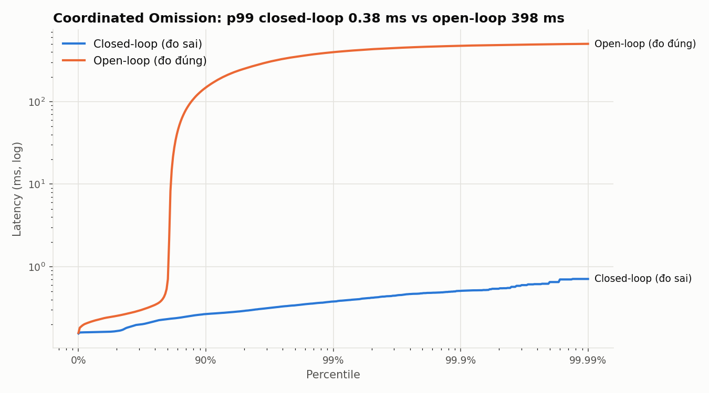
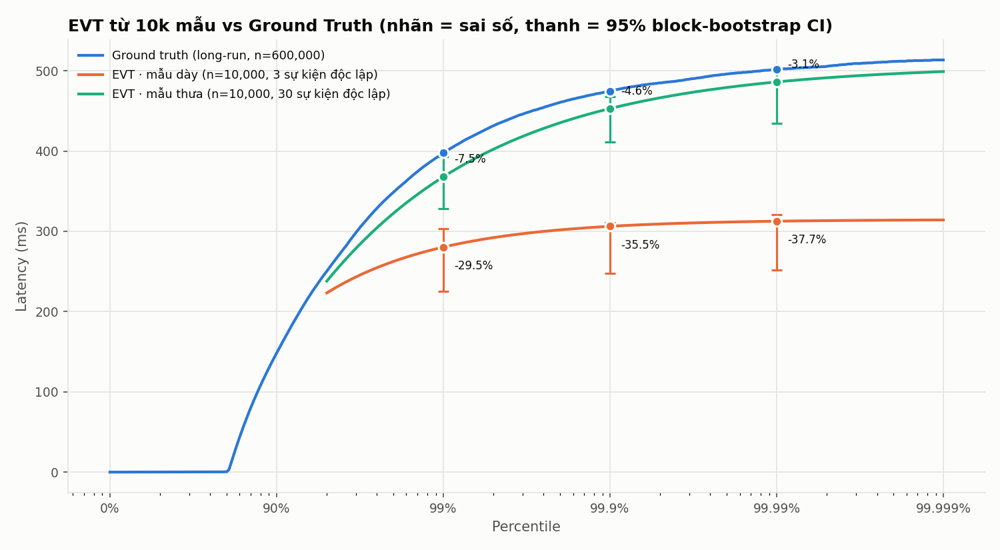
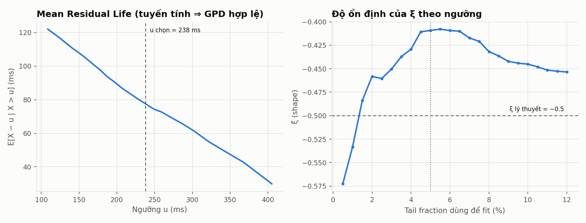
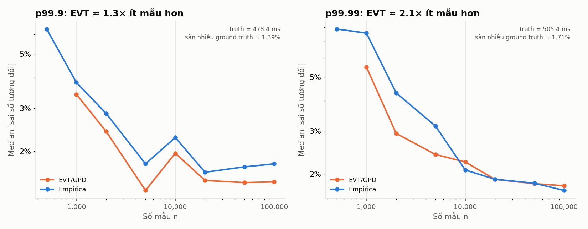

# NineSight — Tail-latency harness + Extreme Value Theory

Đo tail latency **đúng** (open-loop, không Coordinated Omission) và **ước lượng p99.99+ từ ít mẫu** bằng
Extreme Value Theory (Peaks-over-Threshold + Generalized Pareto Distribution).



## Kết quả chính

Đo trên laptop Windows (i7-13700H, loopback), server mode `global`: GC pause ~ U[100, 500] ms mỗi ~2 s, tải 2000 RPS.
Số liệu đầy đủ nằm trong `results/summary.json`.

**1. Coordinated Omission** — cùng một server:

| Cách đo | p50 | p99 | p99.9 |
|---|---|---|---|
| Closed-loop (benchmark "thông thường") | 0.17 ms | **0.38 ms** | 0.51 ms |
| Open-loop (NineSight) | 0.25 ms | **398 ms** | 475 ms |

Closed-loop báo p99 thấp hơn thực tế **~1000×** — toàn bộ các đợt pause bị "xóa sổ".

**2. Overhead của harness**: scheduler lag p99.9 = 30 µs = **0.006%** của p99.9 đo được; 0 request bị drop trên 600k.
HdrHistogram khớp percentile chính xác trong **≤ 0.1%** (unit test, 1M mẫu lognormal).

**3. EVT từ 10.000 mẫu vs ground truth 600.000 mẫu** (fig2):

| Mẫu 10k | Sự kiện độc lập | p99 | p99.9 | p99.99 |
|---|---|---|---|---|
| Dày (5 s liên tiếp) | 3 | −29.5% | −35.5% | −37.7% |
| Thưa (100 s, ghi 1/20 request, cùng tải) | 30 | −7.5% | −4.6% | **−3.1%** (95% CI chứa truth) |

GPD fit trên mẫu thưa cho **ξ = −0.41**, gần giá trị lý thuyết −0.5, và cận trên ước lượng **507 ms** (max đo được: 515 ms).

**4. Hiệu suất mẫu** (fig4, 40 lần lấy mẫu ngẫu nhiên mỗi cỡ n): để đạt cùng sai số, percentile thực nghiệm cần
**~1.3–3× nhiều mẫu hơn** EVT (dao động giữa các lần chạy); từ ~10k mẫu cả hai chạm sàn nhiễu của ground truth (~1.5%).
Với đuôi bị chặn như workload này, lợi thế của EVT là khiêm tốn — xem phần *Bài học*.

| | |
|---|---|
|  |  |
|  | |

## Kiến trúc

```
                         ┌─ringA─> [Sender] ─ringB─> [Receiver] ─> HdrHistogram ─┐
[Scheduler: TSC spin] ───┤          (per connection, lock-free SPSC rings)        ├─> .hgrm / CSV ─> Python EVT
  intended_i = t0 + i/λ  └─ringA─> [Sender] ─ringB─> [Receiver] ─> HdrHistogram ─┘
```

- **Scheduler** không bao giờ chạm socket ⇒ không bao giờ bị server/mạng chặn. Ring đầy ⇒ đếm `dropped`, không dừng lịch.
- **Latency = recv_time − intended_send_time** ⇒ thời gian xếp hàng khi server stall được tính đủ.
- **Không allocate khi đo**: ring, histogram, buffer raw đều cấp phát trước. HdrHistogram dùng bộ nhớ cố định (sai số ≤ 0.1%).
- **Tự kiểm tra overhead**: harness đo lag của chính scheduler và cảnh báo nếu lag > 5% của p99.9 đo được.
- **Timeout trung thực**: request không có response khi kết thúc vẫn được ghi vào histogram (latency cận dưới).

```
common/      timer.hpp (rdtsc) · hdr_histogram.hpp · spsc_ring.hpp · net.hpp · args.hpp
target/      dummy_server.cpp      HTTP /ping; stall: request (1%/req) | global (GC stop-the-world) | none
harness/     closed_loop.cpp       naive closed-loop (đo sai, có chủ đích) + HdrHistogram CO-correction
             open_loop.cpp         open-loop harness (N connection, warmup, raw sampling 1/K)
analysis/    evt_gpd.py            POT/GPD, declustering, block bootstrap CI, chẩn đoán ngưỡng
             plot_validation.py    fig1–fig4 + summary.json
tests/       test_hdr.cpp, test_evt.py
scripts/     run_demo.ps1          build → test → benchmark → EVT → biểu đồ
```

## Phương pháp EVT

1. **Ngưỡng** u = quantile 95% của mẫu; kiểm chứng bằng Mean Residual Life plot (tuyến tính) và độ ổn định của ξ (fig3).
2. **Fit** GPD bằng MLE trên excess `y = x − u` (`scipy.stats.genpareto.fit(floc=0)`).
3. **Quantile**: `x_p = u + (σ/ξ)·[((1−p)/ζ_u)^(−ξ) − 1]`, với `ζ_u = n_u/n`.
4. **Phụ thuộc thời gian**: một stall sinh ra cả nghìn mẫu chậm liên tiếp ⇒ exceedance tụ cụm. Runs declustering
   đếm **số sự kiện cực trị độc lập** (cảnh báo khi < 30) và **moving-block bootstrap** cho CI giữ nguyên cấu trúc cụm.
5. **Kiểm chứng lý thuyết**: với pause D ~ U[a, b], `P(L > x) ∝ (b − x)²` gần cận trên — chính xác là GPD với **ξ = −½**.

Chi tiết toán học nằm trong docstring của [analysis/evt_gpd.py](analysis/evt_gpd.py).

## Build & chạy

```powershell
mingw32-make all test            # Linux/macOS: make all test
powershell -ExecutionPolicy Bypass -File scripts\run_demo.ps1            # ~8 phút
powershell -ExecutionPolicy Bypass -File scripts\run_demo.ps1 -LongSeconds 60   # bản nhanh
```

Yêu cầu: g++ ≥ 9 (C++17), Python 3.10+ với numpy, scipy, matplotlib.

## Bài học rút ra

- **Đếm sự kiện, không đếm request.** 10.000 mẫu liên tiếp trong 5 giây chỉ chứa 2 stall ⇒ EVT sai ~−38%.
  Cùng 10.000 mẫu nhưng lấy rải đều trong 100 giây (~40 stall) ⇒ sai số còn vài phần trăm.
- **Mẫu phải cùng tải.** Lấy mẫu ở rate thấp hơn làm thay đổi phân phối (backlog sau mỗi pause tỷ lệ với λ·D).
  Cách đúng là giữ nguyên tải và chỉ *ghi* 1/K request (`--raw-every K`), giống sampled tracing trong production.
- **Ground truth phải dừng (stationary).** Một lần chạy bị một sự kiện OS ~660 ms (ngoài mô hình server) làm p99.99
  nhảy từ 502 lên 640 ms; một lần khác chính scheduler bị đóng băng 220 ms — self-check của harness đã cảnh báo.
  `plot_validation.py` giờ kiểm tra p99.9 theo từng cửa sổ 30 s và gắn cờ run không dừng.
- **EVT không tạo ra thông tin chưa quan sát.** Với đuôi bị chặn (ξ < 0) như workload này, percentile thực nghiệm
  đã khá tốt; lợi thế của EVT là hiệu suất mẫu và khả năng ngoại suy có khoảng tin cậy.

## Hạn chế / hướng tiếp theo

- Windows: scheduler có thể bị preempt (spike lag vài chục ms trên run dài) — đã nâng priority; trên Linux nên dùng
  `SCHED_FIFO` + `isolcpus`.
- Workload đuôi nặng (pause ~ Pareto, ξ > 0) — nơi EVT được kỳ vọng vượt trội rõ nhất so với percentile thực nghiệm.
- Server dùng thread-per-connection + blocking I/O; thay bằng epoll/IOCP để đo được tải cao hơn.
